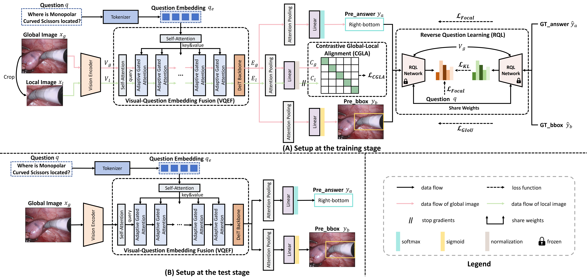

# Enforcing-Answer-Location-Consistency-for-Surgical-VQLA-via-Reverse-Question-Learning
# Introduction
Hi, this is the code repository for "Enforcing Answer-Location Consistency for Surgical Visual Question Localized-Answering via Reverse Question Learning" (Accepted by ACM MM 2026) in PyTorch.



In this paper, we propose a novel surgical VQLA framework to enforce the semantic consistency between predicted answers and their corresponding visual locations. Specifically, we introduce a reverse question learning module, which projects predicted answers, locations and visual contexts back into the question embedding space to build joint semantic constraints for regularization. Besides, we design a contrastive learning-based global-local alignment module to align whole images with question-related local patches, helping the model capture fine-grained visual cues. We validate our method on EndoVis-18-VQLA, EndoVis-17-VQLA and our in-house SGH-VQLA dataset, and it outperforms existing state-of-the-art surgical VQLA methods.

# Citation
If you are interested in this work, please cite the following work:
```bibtex
@inproceedings{10.1145/3767308.3836518,
author = {Guan, Jiale and Zou, Xiaoyang and Zheng, Guoyan},
title = {Enforcing Answer-Location Consistency for Surgical Visual Question Localized-Answering via Reverse Question Learning},
year = {2026},
isbn = {9798400722134},
publisher = {Association for Computing Machinery},
address = {New York, NY, USA},
url = {https://doi.org/10.1145/3767308.3836518},
doi = {10.1145/3767308.3836518},
booktitle = {Proceedings of the 34th ACM International Conference on Multimedia},
pages = {2510–2518},
numpages = {9},
keywords = {robot-assisted surgery, visual question localized-answering, reverse question learning, contrastive global-local alignment},
location = {Rio de Janeiro, Brazil},
series = {MM '26}
}
